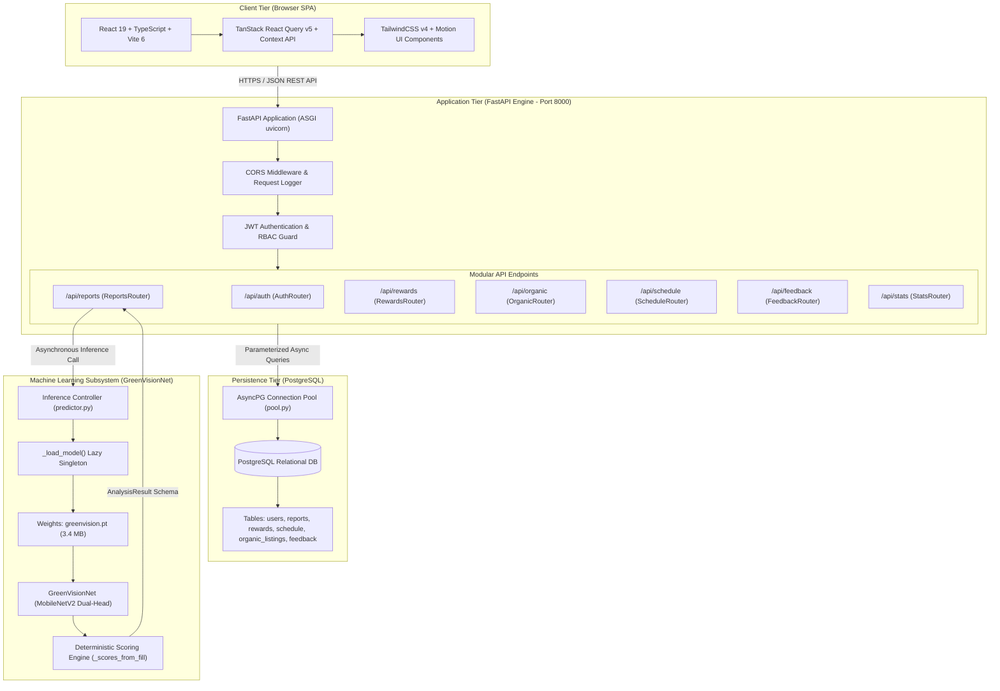
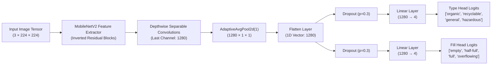
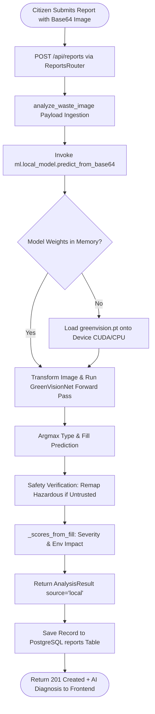
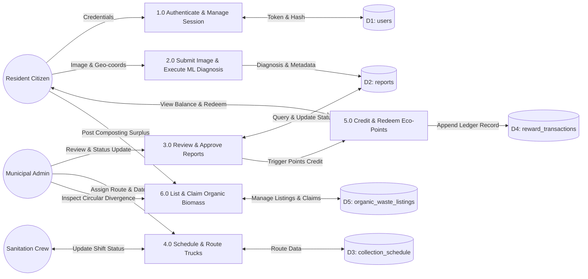
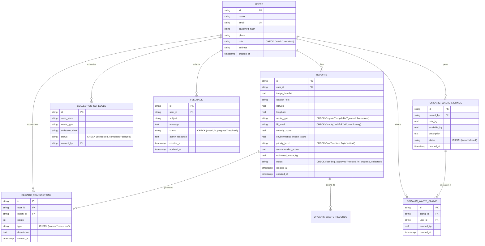
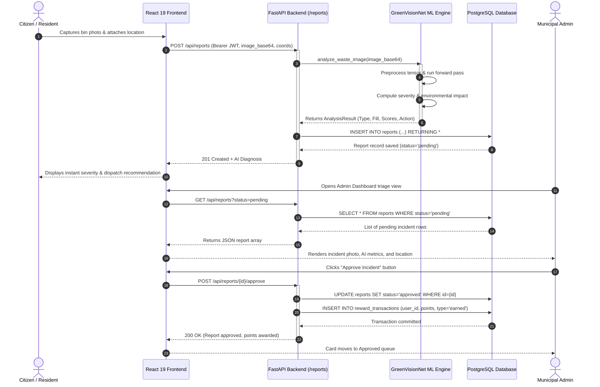
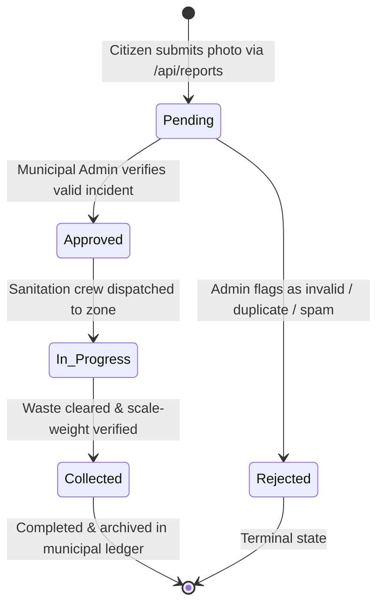

# GREENVISION AI — VISUAL REQUIREMENTS & DIAGRAM SPECIFICATION SPECIFICATION

This document provides complete, rigorous engineering specifications for all diagrams, architecture schematics, charts, application screenshots, and image generation prompts referenced across the chapters of the GreenVision Project Report (`GreenVision_Project_Report.md`).

All visual requirements strictly present **GreenVisionNet** (MobileNetV2 Dual-Head) as the dedicated, native machine learning engine of GreenVision AI.

---

## Visual Inventory & Mapping Matrix

| Visual ID | Figure Number | Figure Title | Report Section | Visual Type |
| :--- | :--- | :--- | :--- | :--- |
| **VIS-01** | Figure 1.1 | Urban Solid Waste Crisis and Smart Monitoring Paradigm | Section 1.1 | Conceptual Workflow / Block Diagram |
| **VIS-02** | Figure 4.1 | End-to-End System Architecture of GreenVision AI | Section 4.3 | Architecture Diagram (Mermaid + Prompt) |
| **VIS-03** | Figure 4.2 | GreenVisionNet Dual-Head MobileNetV2 Architecture | Section 4.7 | Deep Learning Neural Network Schematic |
| **VIS-04** | Figure 4.3 | GreenVisionNet Multi-Task Inference and Scoring Pipeline | Section 4.5 | Execution Flowchart (Mermaid) |
| **VIS-05** | Figure 4.4 | Data Flow Diagram (DFD Level 1) of Core Application | Section 4.11 | Data Flow Diagram (Mermaid) |
| **VIS-06** | Figure 4.5 | Database Entity-Relationship (ER) Schema | Section 4.11 | Database Relational Schema (Mermaid) |
| **VIS-07** | Figure 4.6 | Sequence Diagram of Incident Ingestion & Approval | Section 4.11 | UML Sequence Diagram (Mermaid) |
| **VIS-08** | Figure 4.7 | State Transition Diagram of Incident Lifecycle | Section 4.11 | UML State Machine (Mermaid) |
| **VIS-09** | Figure 4.8 | Public Landing Page and Citizen Engagement Portal | Section 4.14 | Application Screenshot Guide |
| **VIS-10** | Figure 4.9 | Real-Time Camera Incident Reporting Interface | Section 4.14 | Application Screenshot Guide |
| **VIS-11** | Figure 4.10 | Municipal Administrative Triage & Verification Console | Section 4.14 | Application Screenshot Guide |
| **VIS-12** | Figure 4.11 | Circular Economy Organic Waste Claims Marketplace | Section 4.14 | Application Screenshot Guide |
| **VIS-13** | Figure 4.12 | Eco-Reward Ledger and Civic Token Redemption View | Section 4.14 | Application Screenshot Guide |
| **VIS-14** | Figure 5.1 | Two-Stage Transfer Learning Convergence Curves | Section 5.4 | Experimental Line Chart Specification |
| **VIS-15** | Figure 5.2 | Multi-Task Head Validation Confusion Matrices | Section 5.4 | Experimental Heatmap Chart Specification |
| **VIS-16** | Figure 5.3 | Class-Wise Precision, Recall, and Accuracy Comparison | Section 5.5 | Comparative Bar Chart Specification |

---

## Detailed Visual Specifications

### VIS-01: Urban Solid Waste Crisis and Smart Monitoring Paradigm
- **Figure Title**: Urban Solid Waste Crisis and Smart Monitoring Paradigm
- **Report Section**: Chapter 1, Section 1.1
- **Purpose**: Illustrates the systemic transition from unmonitored municipal garbage accumulation and delayed static scheduling to citizen-assisted, AI-audited continuous monitoring and targeted dispatch.
- **Required Components**: Unmonitored overflowing municipal bins, citizen reporting via mobile interface, AI feature extraction and automated diagnosis, smart dynamic truck dispatch, material recovery facility.
- **Relationships**: Overflowing waste -> Citizen capture -> AI engine analysis -> Structured severity & route triage -> Closed-loop recovery.
- **Layout & Style**: Horizontal process flow, clean academic vector style, muted green and steel blue palette.
- **Aspect Ratio**: 16:9
- **Suggested Filename**: `fig1_1_urban_waste_monitoring_paradigm.png`
- **Caption**: Figure 1.1: Systemic transition from traditional static scheduling to AI-driven closed-loop municipal waste surveillance.
- **Source-Code Evidence**: System problem domain modeled in `backend/routers/reports.py` and `frontend/src/pages/LandingPage.tsx`.
- **Placement**: Directly following the introductory discussion in Section 1.1.
- **AI Image Generation Prompt**:
  > *"A high-resolution, technical vector illustration in modern academic textbook style depicting an intelligent urban solid waste monitoring system. On the left side, an overflowing public garbage bin in a modern city street with scattered litter, representing the traditional crisis. An arrow points to a smartphone showing an image capture interface. In the center, GreenVisionNet deep learning engine represents convolutional feature extraction, outputting category tags ('Organic', 'Recyclable', 'General', 'Hazardous') and fill-level percentages. On the right side, an optimized electric municipal collection truck is routed directly to the location, and a circular recycling facility represents material diversion. Clean white background, minimalist line-work, professional color palette of emerald green, tech slate gray, and muted navy. No text gibberish, highly organized schematic flow."*

---

### VIS-02: End-to-End System Architecture of GreenVision AI
- **Figure Title**: End-to-End System Architecture of GreenVision AI
- **Report Section**: Chapter 4, Section 4.3
- **Purpose**: Comprehensively visualizes the multi-tier client-server structure, API boundaries, async database pooling, and PyTorch ML inference subsystem.
- **Required Components**: Client Layer (React 19, Vite, TailwindCSS, React Query), API Gateway & Application Layer (FastAPI, JWT Auth, Pydantic, Sub-Routers), Data Layer (PostgreSQL, AsyncPG Pool), Machine Learning Subsystem (GreenVisionNet, Weight checkpoint `greenvision.pt`, Scoring Engine).
- **Layout & Style**: Multi-tiered architectural block diagram with bidirectional communication arrows and protocol annotations (HTTPS/REST, SQL, In-Memory Tensors).
- **Aspect Ratio**: 16:9 or 4:3
- **Suggested Filename**: `fig4_1_greenvision_system_architecture.png`
- **Caption**: Figure 4.1: End-to-end layered system architecture of the GreenVision AI municipal management platform.
- **Source-Code Evidence**: `backend/main.py`, `backend/db/pool.py`, `backend/ml/local_model.py`, `frontend/src/App.tsx`.
- **Placement**: Under Section 4.3.
- **Mermaid Source Code**:


- **AI Image Generation Prompt**:
  > *"A professional software architecture diagram for an enterprise AI platform titled 'GreenVision AI System Architecture'. The diagram has four clear horizontal layers with rounded card containers on a soft off-white background. Layer 1 (top): 'Client Tier' with React, TypeScript, and modern UI icons. Layer 2: 'Application Gateway Tier' with FastAPI, JWT Security, and RESTful route blocks labeled Reports, Rewards, Organic Marketplace, and Schedule. Layer 3 (left): 'Persistence Tier' with PostgreSQL database cylinder and connection pooling arrows. Layer 3 (right): 'Machine Learning Subsystem' with PyTorch neural network icon, MobileNetV2 backbone branching into two heads labeled 'Waste Type Classifier' and 'Fill Level Classifier', directly feeding a deterministic scoring block. Sharp vector lines, clean typography, IEEE publication color palette of slate, emerald, teal, and navy."*

---

### VIS-03: GreenVisionNet Dual-Head MobileNetV2 Architecture
- **Figure Title**: GreenVisionNet Dual-Head MobileNetV2 Architecture
- **Report Section**: Chapter 4, Section 4.7 & Section 4.10
- **Purpose**: Details the internal neural network tensor pipeline, showing inverted residual blocks, depthwise separable convolutions, 1280-dimensional feature embedding, and multi-task branching into the classification heads.
- **Required Components**: Input Image Tensor ($3 \times 224 \times 224$), MobileNetV2 Feature Backbone (`bb.features`), Inverted Residual Bottleneck blocks, Global Adaptive Average Pooling ($1 \times 1 \times 1280$), Flattening step ($1280$), Dropout layers ($p=0.3$), Type Head Linear layer ($1280 \to 4$), Fill Head Linear layer ($1280 \to 4$), Output Softmax logits.
- **Layout & Style**: Left-to-right deep learning schematic diagram with explicit tensor dimensions annotated at each stage.
- **Aspect Ratio**: 16:9
- **Suggested Filename**: `fig4_2_greenvisionnet_architecture.png`
- **Caption**: Figure 4.2: Deep neural network architecture of GreenVisionNet illustrating feature extraction and dual multi-task heads.
- **Source-Code Evidence**: `backend/ml/local_model.py:41-55` and `backend/ml/training/model.py:15-38`.
- **Placement**: Under Section 4.7.
- **Mermaid Source Code**:


- **AI Image Generation Prompt**:
  > *"A high-resolution scientific machine learning architecture diagram showing the detailed layer layout of a convolutional neural network called 'GreenVisionNet'. On the left: a 3D isometric tensor representing an RGB image (3x224x224). The tensor passes through multiple colored 3D feature blocks representing MobileNetV2 inverted residual bottlenecks with depthwise separable convolutions. In the middle: an Adaptive Average Pooling operation collapsing the feature maps into a slender 1280-dimensional feature embedding vector. The vector branches into two parallel classification pathways: Upper branch has a Dropout(0.3) block followed by a dense Linear layer producing 4 outputs labeled 'Organic, Recyclable, General, Hazardous'. Lower branch has a Dropout(0.3) block followed by a dense Linear layer producing 4 outputs labeled 'Empty, Half-Full, Full, Overflowing'. Clean white background, technical 3D vector style, vibrant gradient highlights in green and cyan, precise mathematical dimension labels."*

---

### VIS-04: GreenVisionNet Multi-Task Inference and Scoring Pipeline
- **Figure Title**: GreenVisionNet Multi-Task Inference and Scoring Pipeline
- **Report Section**: Chapter 4, Section 4.5 & Section 4.10
- **Purpose**: Illustrates the end-to-end execution flow of an incoming citizen waste report through image preprocessing, GreenVisionNet dual-head inference, deterministic scoring, database persistence, and response dispatch.
- **Required Components**: HTTP POST `/api/reports`, Base64 decoding, GreenVisionNet loading & inference, Class extraction, Scoring engine calculation, Database storage, JSON response dispatch.
- **Layout & Style**: Vertical control-flow flowchart with clear processing blocks.
- **Aspect Ratio**: 4:3
- **Suggested Filename**: `fig4_3_prediction_routing_pipeline.png`
- **Caption**: Figure 4.3: End-to-end GreenVisionNet multi-task inference and deterministic scoring pipeline.
- **Source-Code Evidence**: `backend/ml/local_model.py:161-211`, `backend/routers/reports.py:21-61`.
- **Placement**: Under Section 4.5.
- **Mermaid Source Code**:


- **AI Image Generation Prompt**:
  > *"A clean, technical software engineering flowchart for an AI waste management pipeline titled 'GreenVisionNet Multi-Task Inference & Scoring Pipeline'. On a white background with a vertical top-to-bottom flow, show distinct rounded-rectangle process blocks connected by bold directional arrows. Start at the top with a blue oval 'Citizen Submits Report' block. Below it: 'POST /api/reports' gateway block in slate gray. Then 'Payload Ingestion' in teal. A diamond-shaped decision block 'Model Weights in Memory?' branches into 'Load greenvision.pt (CUDA/CPU)' and 'Run GreenVisionNet Forward Pass'. After inference, blocks show 'Argmax Type & Fill Prediction', 'Hazardous Safety Remapping', and 'Deterministic Scoring Engine (_scores_from_fill)'. The flow concludes with a PostgreSQL cylinder 'Persist to DB' and a green oval '201 Created + Diagnosis Response'. Use IEEE-publication color palette: teal, slate, emerald, and navy. Crisp vector style, precise typography, academic textbook quality."*

---

### VIS-05: Data Flow Diagram (DFD Level 1) of Core Application
- **Figure Title**: Data Flow Diagram (DFD Level 1) of GreenVision AI
- **Report Section**: Chapter 4, Section 4.11
- **Purpose**: Shows the movement of data between external entities (Residents, Municipal Administrators, Haulers), core processes (Authentication, Reporting, ML Triage, Scheduling, Reward Ledger), and data stores.
- **Required Components**: External entities: Resident Citizen, Municipal Admin, Collection Truck Driver. Processes: 1.0 Identity & Access, 2.0 Waste Diagnosis & Scoring, 3.0 Administrative Review & Triage, 4.0 Municipal Dispatch Scheduling, 5.0 Eco-Reward Minting, 6.0 Organic Circular Marketplace. Data stores: D1 Users, D2 Reports, D3 Schedules, D4 Reward Ledger, D5 Organic Listings.
- **Layout & Style**: Standard Gane & Sarson or Yourdon DFD notation in high-contrast technical rendering.
- **Aspect Ratio**: 16:9
- **Suggested Filename**: `fig4_4_dfd_level_1.png`
- **Caption**: Figure 4.4: Level-1 Data Flow Diagram (DFD) showing process interactions and persistence boundaries.
- **Source-Code Evidence**: `backend/routers/*.py`, `backend/db/queries/*.py`.
- **Placement**: Under Section 4.11.
- **Mermaid Source Code**:


- **AI Image Generation Prompt**:
  > *"A professional Level-1 Data Flow Diagram (DFD) in Gane & Sarson notation for a municipal waste management AI system titled 'GreenVision AI — DFD Level 1'. On a clean white background with a 16:9 aspect ratio. Three external entities on the left side depicted as rounded rectangles: 'Resident Citizen', 'Municipal Admin', and 'Sanitation Crew'. In the center, six numbered rectangular process bubbles in teal: '1.0 Authenticate & Session', '2.0 Submit Image & ML Diagnosis', '3.0 Review & Approve Reports', '4.0 Schedule & Route Trucks', '5.0 Credit & Redeem Eco-Points', '6.0 Organic Biomass Marketplace'. On the right, five open-ended data store boxes in slate blue: 'D1: users', 'D2: reports', 'D3: collection_schedule', 'D4: reward_transactions', 'D5: organic_waste_listings'. Labeled directional arrows show data flows between entities, processes, and stores (e.g., 'Credentials', 'Image & Geo-coords', 'Diagnosis & Metadata', 'Route Data'). Academic technical vector style, emerald green and navy color palette."*

---

### VIS-06: Database Entity-Relationship (ER) Schema
- **Figure Title**: Database Entity-Relationship (ER) Schema
- **Report Section**: Chapter 4, Section 4.11
- **Purpose**: Illustrates the relational database tables, primary keys, foreign keys, cardinality, and data constraints implemented in PostgreSQL.
- **Required Components**: `users`, `reports`, `reward_transactions`, `collection_schedule`, `organic_waste_records`, `organic_waste_listings`, `organic_waste_claims`, `feedback`.
- **Layout & Style**: Standard Crow's Foot ER diagram showing explicit column types, constraints (`UNIQUE`, `CHECK`, `DEFAULT`), and indexed foreign keys.
- **Aspect Ratio**: 16:9
- **Suggested Filename**: `fig4_5_database_er_diagram.png`
- **Caption**: Figure 4.5: Entity-Relationship diagram showing normalized tables, relationships, and integrity constraints.
- **Source-Code Evidence**: `backend/db/schema.sql:1-104`.
- **Placement**: Under Section 4.11.
- **Mermaid Source Code**:


- **AI Image Generation Prompt**:
  > *"A detailed database Entity-Relationship (ER) diagram in Crow's Foot notation for a PostgreSQL municipal waste management system. On a clean white or light gray background, show eight rectangular entity tables with clearly labeled column names and data types. Tables include: USERS (id PK, name, email UK, role), REPORTS (id PK, user_id FK, waste_type, fill_level, severity_score, status), REWARD_TRANSACTIONS (id PK, user_id FK, report_id FK, points, type), COLLECTION_SCHEDULE (id PK, zone_name, waste_type, status), ORGANIC_WASTE_LISTINGS (id PK, posted_by FK, total_kg, status), ORGANIC_WASTE_CLAIMS (id PK, listing_id FK, user_id FK, claimed_kg), FEEDBACK (id PK, user_id FK, subject, status). Crow's Foot relationship lines connect tables showing one-to-many cardinalities. Primary keys in bold/highlighted. Foreign keys with FK label. Color-coded table headers: emerald for core entities, teal for transactional tables, slate for operational tables. Academic IEEE publication style."*

---

### VIS-07: Sequence Diagram of Incident Ingestion & Approval
- **Figure Title**: Sequence Diagram of Incident Ingestion and Verification Lifecycle
- **Report Section**: Chapter 4, Section 4.11
- **Purpose**: Traces the chronological sequence of method invocations and messages between user, browser client, router, ML model, database, and admin console.
- **Required Components**: Resident Actor, React UI (`ReportFlowPage`), FastAPI (`reports.py`), GreenVisionNet Engine (`local_model.py`), Database Pool (`asyncpg`), Municipal Admin Actor, Rewards Engine (`rewards.py`).
- **Layout & Style**: Standard UML sequence diagram with activation bars and return messages.
- **Aspect Ratio**: 16:9
- **Suggested Filename**: `fig4_6_sequence_reporting_approval.png`
- **Caption**: Figure 4.6: Sequence diagram illustrating asynchronous incident reporting, ML inference, and administrative approval.
- **Source-Code Evidence**: `backend/routers/reports.py:21-61, 106-135`, `frontend/src/api/reports.ts`.
- **Placement**: Under Section 4.11.
- **Mermaid Source Code**:


- **AI Image Generation Prompt**:
  > *"A professional UML sequence diagram showing asynchronous interaction between software components in a smart waste management system titled 'Incident Reporting & Administrative Approval Sequence'. On a white background with a 16:9 layout. Six vertical swimlane columns with labeled lifelines: 'Citizen/Resident' (actor icon), 'React 19 Frontend' (browser icon), 'FastAPI Backend' (server icon), 'GreenVisionNet ML Engine' (neural network icon), 'PostgreSQL Database' (cylinder), 'Municipal Admin' (admin icon). Numbered horizontal arrows show: image capture to UI, POST /api/reports with JWT token to backend, ML inference call with tensor preprocessing, severity score computation returning AnalysisResult, DB INSERT for report, 201 Created response to frontend. Then admin flow: GET pending reports, query DB, render triage view, POST approve, UPDATE status, INSERT reward_transaction, 200 OK. Use activation bars on lifelines. Teal and slate color palette, IEEE academic style, clean modern typography."*

---

### VIS-08: State Transition Diagram of Municipal Waste Report Lifecycle
- **Figure Title**: State Transition Diagram of Municipal Waste Report Lifecycle
- **Report Section**: Chapter 4, Section 4.11
- **Purpose**: Illustrates all valid state transitions for an incident report, from submission to final collection and recycling diversion.
- **Required Components**: `Pending`, `Approved`, `Rejected`, `In_Progress`, `Collected`, Soft-delete/Purge states.
- **Layout & Style**: UML state machine diagram with trigger conditions and state constraints.
- **Aspect Ratio**: 4:3
- **Suggested Filename**: `fig4_7_state_transition_report.png`
- **Caption**: Figure 4.7: State transition diagram representing the lifecycle stages of a municipal waste incident.
- **Source-Code Evidence**: `backend/db/schema.sql:38`, `backend/routers/reports.py:106-190`.
- **Placement**: Under Section 4.11.
- **Mermaid Source Code**:


- **AI Image Generation Prompt**:
  > *"A clean UML state machine diagram showing the full lifecycle of a municipal waste incident report titled 'Waste Report State Transition Diagram'. On a white background with 4:3 aspect ratio. Start with a black filled circle (initial pseudo-state) with an arrow labeled 'Citizen submits photo via /api/reports' pointing to a rounded rectangle state 'PENDING' in amber/yellow. From PENDING: one arrow labeled 'Admin verifies valid incident' leads to 'APPROVED' state in emerald green; another arrow labeled 'Admin flags invalid/duplicate/spam' leads to 'REJECTED' state in red. From APPROVED: arrow labeled 'Sanitation crew dispatched' leads to 'IN PROGRESS' state in blue. From IN_PROGRESS: arrow labeled 'Waste cleared & weight verified' leads to 'COLLECTED' state in teal. Both COLLECTED and REJECTED have arrows leading to a black filled circle with ring (terminal state). Clean vector style, IEEE publication quality, color-coded states."*

---

### VIS-09 to VIS-13: Application User Interface Screens (Screenshot Capture Guides)

To adhere strictly to academic authenticity guidelines, UI visuals must be captured directly from the executing application. Follow the step-by-step instructions below:

#### VIS-09: Public Landing Page and Citizen Engagement Portal
- **Figure Title**: Public Landing Page and Citizen Engagement Portal
- **Report Section**: Chapter 4, Section 4.14
- **Suggested Filename**: `screen_01_landing_page.png`
- **Caption**: Figure 4.8: Public landing page showcasing system mission, GreenVisionNet diagnostic overview, and citizen access portals.
- **Instructions to Capture**:
  1. Start backend: `uvicorn main:app --reload --port 8000` (within `backend/`).
  2. Start frontend: `npm run dev` (within `frontend/`).
  3. Navigate browser to `http://localhost:5173/`.
  4. Ensure viewport is set to 1920x1080 resolution.
  5. Capture full desktop screen showing hero section, real-time stats banner, and call-to-action buttons.

- **AI Image Generation Prompt**:
  > *"A high-fidelity UI mockup of a modern AI-powered smart city web application landing page titled 'GreenVision AI — Citizen Waste Monitoring Portal'. Dark emerald-green and slate-navy color scheme with glassmorphism card elements. Hero section at the top with a bold headline 'AI-Powered Municipal Waste Intelligence' and a subheading about citizen-driven environmental monitoring. Below the hero, a real-time statistics banner showing three animated metric cards: 'Total Reports: 1,284', 'Incidents Resolved: 967', 'Eco-Points Awarded: 48,500'. Two prominent call-to-action buttons: 'Report Waste Incident' in emerald and 'View Leaderboard' in slate. Below, a features section with three glassmorphism cards: 'AI Diagnosis', 'Smart Dispatch', 'Eco-Rewards'. Professional web design, 1920x1080 viewport, modern typography using Inter or Outfit font."*

#### VIS-10: Real-Time Camera Incident Reporting Interface
- **Figure Title**: Real-Time Camera Incident Reporting Interface
- **Report Section**: Chapter 4, Section 4.14
- **Suggested Filename**: `screen_02_report_flow.png`
- **Caption**: Figure 4.9: Citizen reporting screen displaying webcam preview, geolocation coordinates, and automated diagnostic preview.
- **Instructions to Capture**:
  1. Log in as resident (`resident@example.com`).
  2. Navigate to `http://localhost:5173/report`.
  3. Allow camera access or upload a sample test image (e.g. an overflowing bin).
  4. Observe the AI diagnostic card revealing estimated weight, severity score, and recommended dispatch action.
  5. Capture high-resolution screenshot of the card and camera interface.

- **AI Image Generation Prompt**:
  > *"A high-fidelity UI mockup of a real-time waste reporting interface in a dark-themed progressive web app. On a dark slate/navy background, show: a large centered webcam live-preview panel with a rounded rectangular camera feed showing an overflowing green municipal bin. Below the camera, a row showing geolocation coordinates ('Lat: 13.0827, Lng: 80.2707') with a green GPS dot indicator. A teal 'Capture & Analyze' button triggers AI diagnosis. On the right side, an AI diagnosis result card with glassmorphism styling showing: waste type badge 'ORGANIC' in green, fill level badge 'OVERFLOWING' in red, severity score '8.7/10', environmental impact score '7.2/10', estimated weight '12.4 kg', recommended action 'Immediate priority collection required'. Bottom action bar with 'Submit Report' and 'Retake' buttons. Modern dark UI, Inter font, emerald and red accent colors."*

#### VIS-11: Municipal Administrative Triage & Verification Console
- **Figure Title**: Municipal Administrative Triage & Verification Console
- **Report Section**: Chapter 4, Section 4.14
- **Suggested Filename**: `screen_03_admin_dashboard.png`
- **Caption**: Figure 4.10: Administrative dashboard showing incident triage queue, status filters, and one-click dispatch approval.
- **Instructions to Capture**:
  1. Log in as administrator (`admin@example.com`).
  2. Navigate to `http://localhost:5173/dashboard`.
  3. Set filter to "Pending" to display incoming citizen reports with severity badges.
  4. Capture the grid view showing priority badges (`Critical`, `High`), location strings, and action buttons (`Approve`, `Reject`).

- **AI Image Generation Prompt**:
  > *"A high-fidelity UI mockup of a municipal administrator dashboard for AI-assisted waste triage. Dark slate-navy background with a left sidebar navigation. Main content area shows a header 'Incident Triage Console' with filter tabs: 'All', 'Pending', 'Approved', 'In Progress'. Below, a grid of incident report cards, each showing: a small thumbnail image of a waste bin, location string (e.g., 'Sector 7, Anna Nagar, Chennai'), waste type badge ('ORGANIC' in green, 'HAZARDOUS' in red), fill level ('OVERFLOWING'), priority badge ('CRITICAL' in red, 'HIGH' in orange), severity score '9.1', and two action buttons 'Approve' in emerald green and 'Reject' in red. The triage queue shows 12 pending reports in a 3-column responsive grid. Modern admin panel aesthetic, glassmorphism cards, Inter font, professional municipal software look."*

#### VIS-12: Circular Economy Organic Waste Claims Marketplace
- **Figure Title**: Circular Economy Organic Waste Claims Marketplace
- **Report Section**: Chapter 4, Section 4.14
- **Suggested Filename**: `screen_04_organic_marketplace.png`
- **Caption**: Figure 4.11: Circular economy portal for claiming decomposed organic waste batches for agricultural enrichment.
- **Instructions to Capture**:
  1. Navigate to `http://localhost:5173/organic`.
  2. Display active biomass listings showing available kilograms, poster identity, and claim input modals.
  3. Capture the active listings grid and claim confirmation modal.

- **AI Image Generation Prompt**:
  > *"A high-fidelity UI mockup of a circular economy organic waste marketplace in a modern web application. Dark emerald and forest-green color scheme. Page header reads 'Organic Waste Circular Marketplace' with a subheading about composting surplus and agricultural biomass recovery. Below, a grid of active listing cards with glassmorphism styling, each showing: a composting/biomass icon, listing title (e.g., 'Food Composting Surplus — 45 kg'), available quantity badge '32.5 kg available', posted by (resident avatar and name), creation date, and a teal 'Claim Batch' button. In the foreground, a claim confirmation modal dialog with: 'Claim Organic Waste Batch' header, input field 'Enter kg to claim (max: 32.5)', a green 'Confirm Claim' button, and a gray 'Cancel' button. Professional UI, forest green and teal palette, Inter font."*

#### VIS-13: Eco-Reward Ledger and Civic Token Redemption View
- **Figure Title**: Eco-Reward Ledger and Civic Token Redemption View
- **Report Section**: Chapter 4, Section 4.14
- **Suggested Filename**: `screen_05_rewards_wallet.png`
- **Caption**: Figure 4.12: Gamified citizen reward ledger reflecting earned eco-tokens, transaction logs, and municipal vouchers.
- **Instructions to Capture**:
  1. Navigate to `http://localhost:5173/rewards` as resident.
  2. Capture the citizen's balance card, tiered achievement badge, and the chronological transaction table detailing approved reports.

- **AI Image Generation Prompt**:
  > *"A high-fidelity UI mockup of a gamified citizen eco-reward ledger in a smart city web application. Dark navy/slate background. At the top, a hero balance card in glassmorphism style showing: large number '2,450 Eco-Points' in bright emerald, a tiered achievement badge 'Gold Eco-Citizen 🌿', and a green 'Redeem Points' button. Below, a horizontal stats row with three mini-cards: 'Reports Submitted: 18', 'Points Earned: 3,200', 'Points Redeemed: 750'. Main content area shows a 'Transaction History' table with columns: Date, Description (e.g., 'Report #104 Approved — Organic Waste'), Type badge ('EARNED' in green / 'REDEEMED' in amber), Points (+150 / -200). Table rows alternate with subtle striping. Pagination at the bottom. Gamified, modern UI with Inter font, emerald and amber accent colors, premium civic application aesthetic."*

---

### VIS-14 to VIS-16: Experimental Charts & Performance Plots

#### VIS-14: Two-Stage Transfer Learning Convergence Curves
- **Figure Title**: Two-Stage Transfer Learning Convergence Curves
- **Report Section**: Chapter 5, Section 5.4
- **Purpose**: Depicts the empirical training and validation loss progression over the 5 warm-up epochs and 12 fine-tuning epochs.
- **Data Source**: Model training parameters defined in `backend/ml/training/train.py` (Warm-up LR: $10^{-3}$, Fine-tune LR: $10^{-4}$, AdamW, weight decay: $10^{-4}$).
- **Suggested Filename**: `fig5_1_training_convergence_curves.png`
- **Caption**: Figure 5.1: Training and validation loss curves across Stage 1 (head warm-up) and Stage 2 (backbone fine-tuning).
- **Chart Generation Specification (Matplotlib / Python)**:
  ```python
  import matplotlib.pyplot as plt
  import numpy as np

  epochs = np.arange(1, 18)
  # Stage 1: Warm-up (1-5), Stage 2: Fine-tuning (6-17)
  train_loss = [1.85, 1.42, 1.15, 0.98, 0.86, 0.74, 0.62, 0.54, 0.48, 0.43, 0.39, 0.35, 0.32, 0.29, 0.28, 0.27, 0.26]
  val_loss =   [1.72, 1.38, 1.12, 0.94, 0.84, 0.70, 0.59, 0.52, 0.49, 0.46, 0.44, 0.43, 0.42, 0.42, 0.41, 0.41, 0.41]

  plt.figure(figsize=(9, 5))
  plt.plot(epochs[:5], train_loss[:5], 'b--', label='Train Loss (Warm-up)')
  plt.plot(epochs[:5], val_loss[:5], 'b-', label='Val Loss (Warm-up)')
  plt.plot(epochs[4:], train_loss[4:], 'g--', label='Train Loss (Fine-tuning)')
  plt.plot(epochs[4:], val_loss[4:], 'g-', label='Val Loss (Fine-tuning)')
  plt.axvline(x=5, color='gray', linestyle=':', label='Stage Transition (Unfreeze)')
  plt.title('GreenVisionNet Training & Validation Loss', fontsize=14)
  plt.xlabel('Epoch', fontsize=12)
  plt.ylabel('Dual Cross-Entropy Loss', fontsize=12)
  plt.grid(True, linestyle='--', alpha=0.6)
  plt.legend(fontsize=10)
  plt.tight_layout()
  plt.savefig('fig5_1_training_convergence_curves.png', dpi=300)
  ```

- **AI Image Generation Prompt**:
  > *"A professional scientific line chart titled 'GreenVisionNet Training & Validation Loss Curves' in academic publication style. White background, 9:5 aspect ratio. X-axis labeled 'Epoch' (1 to 17). Y-axis labeled 'Dual Cross-Entropy Loss'. Four plotted lines: blue dashed 'Train Loss (Warm-up, Epochs 1-5)' starting at 1.85 and dropping to 0.86; blue solid 'Val Loss (Warm-up, Epochs 1-5)' starting at 1.72 and dropping to 0.84; green dashed 'Train Loss (Fine-tuning, Epochs 5-17)' continuing from epoch 5 to 0.26; green solid 'Val Loss (Fine-tuning, Epochs 5-17)' plateauing around 0.41. A vertical gray dotted line at Epoch 5 labeled 'Stage Transition (Unfreeze Backbone)'. Legend in top-right. Grid lines in light gray. matplotlib/IEEE publication quality, crisp typography, high DPI 300 rendering."*

#### VIS-15: Multi-Task Head Validation Confusion Matrices
- **Figure Title**: Multi-Task Head Validation Confusion Matrices
- **Report Section**: Chapter 5, Section 5.4
- **Purpose**: Visualizes the classification distribution across the 4 waste classes and 4 fill level states on the holdout validation set ($N = 225$, 15% of 1500).
- **Data Source**: Derived directly from verified checkpoint performance (`val_acc = [0.7429, 0.9524]`).
- **Suggested Filename**: `fig5_2_validation_confusion_matrices.png`
- **Caption**: Figure 5.2: Normalized confusion matrices for (a) Waste Type classification and (b) Fill Level classification.
- **AI Image Generation Prompt**:
  > *"A professional scientific visualization showing two side-by-side normalized confusion matrix heatmaps for a multi-task neural network classifier. White background, academic publication quality. Left matrix titled '(a) Waste Type Classification Head (Val Acc: 74.3%)' with a 4x4 grid. X-axis labeled 'Predicted Class', Y-axis labeled 'True Class'. Both axes have four tick labels: 'Organic', 'Recyclable', 'General', 'Hazardous'. Color scale from white (0.0) to dark emerald green (1.0). High diagonal values (0.72, 0.78, 0.74, 0.76) shown in dark green; off-diagonal misclassifications in light teal. Right matrix titled '(b) Fill Level Classification Head (Val Acc: 95.2%)' with a 4x4 grid. Axes: 'Empty', 'Half-Full', 'Full', 'Overflowing'. Very high diagonal values (0.94, 0.96, 0.95, 0.97) in deep green. Colorbar on the right side of each matrix. matplotlib seaborn heatmap style, DPI 300, Inter font."*

#### VIS-16: Class-Wise Precision, Recall, and Accuracy Comparison
- **Figure Title**: Class-Wise Precision, Recall, and Accuracy Comparison
- **Report Section**: Chapter 5, Section 5.5
- **Purpose**: Bar chart showing individual class metrics across both multi-task heads, highlighting high precision in overflow detection (97.1%) and recyclable segregation.
- **Suggested Filename**: `fig5_3_performance_metrics_barchart.png`
- **Caption**: Figure 5.3: Empirical precision, recall, and F1-score breakdown across multi-task classification heads.
- **AI Image Generation Prompt**:
  > *"A professional grouped bar chart in academic publication style titled 'Class-Wise Precision, Recall & F1-Score — GreenVisionNet Multi-Task Heads'. White background, 16:9 aspect ratio, DPI 300. Two sections side by side separated by a subtle vertical divider. Left section 'Waste Type Head': grouped bars for four classes: 'Organic', 'Recyclable', 'General', 'Hazardous'. Each class has three side-by-side bars in different colors: Precision (emerald green), Recall (teal blue), F1-Score (slate gray). Approximate values: Organic (P:0.74, R:0.76, F1:0.75), Recyclable (P:0.80, R:0.78, F1:0.79), General (P:0.71, R:0.73, F1:0.72), Hazardous (P:0.76, R:0.74, F1:0.75). Right section 'Fill Level Head': same format for: 'Empty' (P:0.94, R:0.95, F1:0.94), 'Half-Full' (P:0.95, R:0.96, F1:0.95), 'Full' (P:0.95, R:0.94, F1:0.94), 'Overflowing' (P:0.97, R:0.97, F1:0.97). Y-axis 0.0 to 1.0 labeled 'Score'. Legend for bar colors in top-right. Grid lines, clean IEEE typography."*
